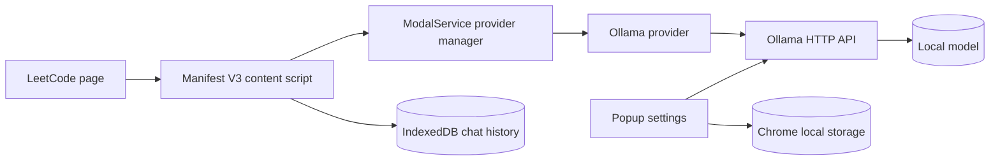

# Code-Bhumi AI

**Learn to Think. Code to Solve. AI to Guide.**

Code-Bhumi is a privacy-conscious Chrome extension that helps learners solve LeetCode problems through progressive hints instead of immediately revealing the answer. The existing Code-Bhumi extension remains the product foundation; this edition adds a local-first Ollama provider and a validated learning-response contract.

## What is implemented

- Local Ollama inference through the official HTTP API.
- Ollama endpoint configuration, installed-model discovery, connection status, request timeout, cancellation support, and malformed-response handling.
- `qwen3:4b` and `gemma3:4b` local presets, with arbitrary installed model names supported.
- Five-level progressive-learning prompt contract: conceptual clue, algorithm/data structure, approach, pseudocode, then a complete solution only when requested.
- Existing LeetCode content-script chat and IndexedDB chat history are preserved.
- Existing Gemini and OpenAI integrations remain available as legacy opt-in providers.
- Structured responses validated with Zod; code is never executed by the extension.
- Dark-first popup with privacy messaging, connection diagnostics, and practical model settings.

## Install locally

```bash
git clone https://github.com/Kumari-smruti/Code-Bhumi.git
cd Code-Bhumi
npm ci
npm run build
```

Open `chrome://extensions`, enable **Developer mode**, choose **Load unpacked**, and select the generated `dist/` directory. Do not load the repository root because the manifest and bundled assets are produced by Vite.

## Ollama setup

Install Ollama from [ollama.com/download](https://ollama.com/download), then install one model:

```bash
ollama pull qwen3:4b
# or
ollama pull gemma3:4b
```

Open the Code-Bhumi popup, keep the endpoint at `http://localhost:11434`, enter the installed model tag, choose **Check connection**, and save the settings. Ollama's `/api/tags` endpoint is used for discovery and `/api/chat` is used for structured JSON responses.

The extension requests access only to `localhost:11434` and `127.0.0.1:11434` for local inference. Source code and problem context remain local when Ollama is selected. Legacy cloud providers are not required and are clearly separate from the local path.

## Development

```bash
npm run dev
npm run typecheck
npm run lint
npm test
npm run build
```

## Architecture



See [docs/ARCHITECTURE.md](docs/ARCHITECTURE.md), [docs/PRIVACY.md](docs/PRIVACY.md), [docs/MODEL-CARD.md](docs/MODEL-CARD.md), and [docs/AI-EVALUATION.md](docs/AI-EVALUATION.md).

## Model and license notes

The application is GPL-3.0, inherited from the existing project. Ollama is an MIT-licensed inference runtime. Model weights have their own terms: Qwen3 is distributed under its Qwen license, while Gemma 3 uses Google's Gemma Terms of Use. Users must review those terms before redistribution or commercial use. “Open-weight” is used deliberately; it is not a claim that every model license is OSI-approved open source.

## Known limitations

The extension does not execute or compile user code, so review and test cases are analysis only. Structured JSON quality depends on the selected model. Ollama must be running on the user's machine, and a model must already be installed. Benchmark results are not claimed until the evaluation harness has been run on a declared hardware setup.

## Contributing

Read [CONTRIBUTING.md](CONTRIBUTING.md), open an issue for a focused change, and run the full verification commands before submitting a pull request. Preserve privacy boundaries, do not commit API keys, and do not add automatic code execution.

## Maintainer

Developed and maintained by [Kumari Smruti](https://github.com/Kumari-smruti). The project is released under [GPL-3.0](LICENSE).
"# Code-Bhumi" 
